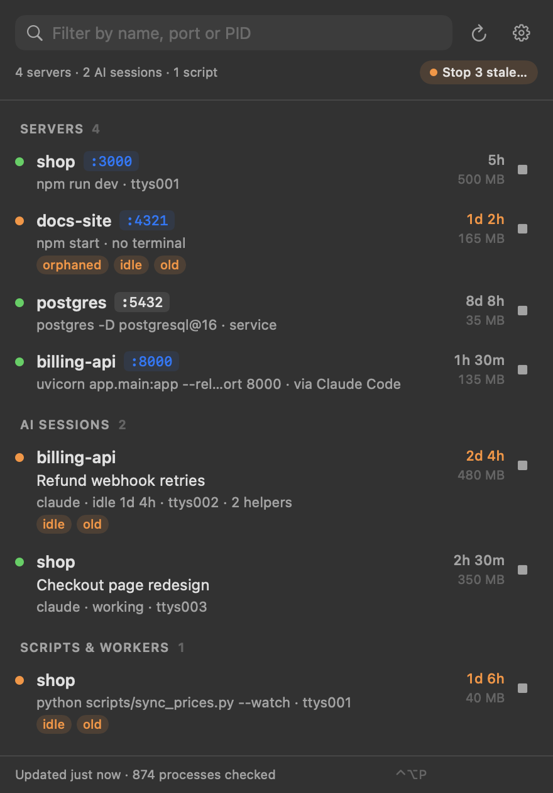
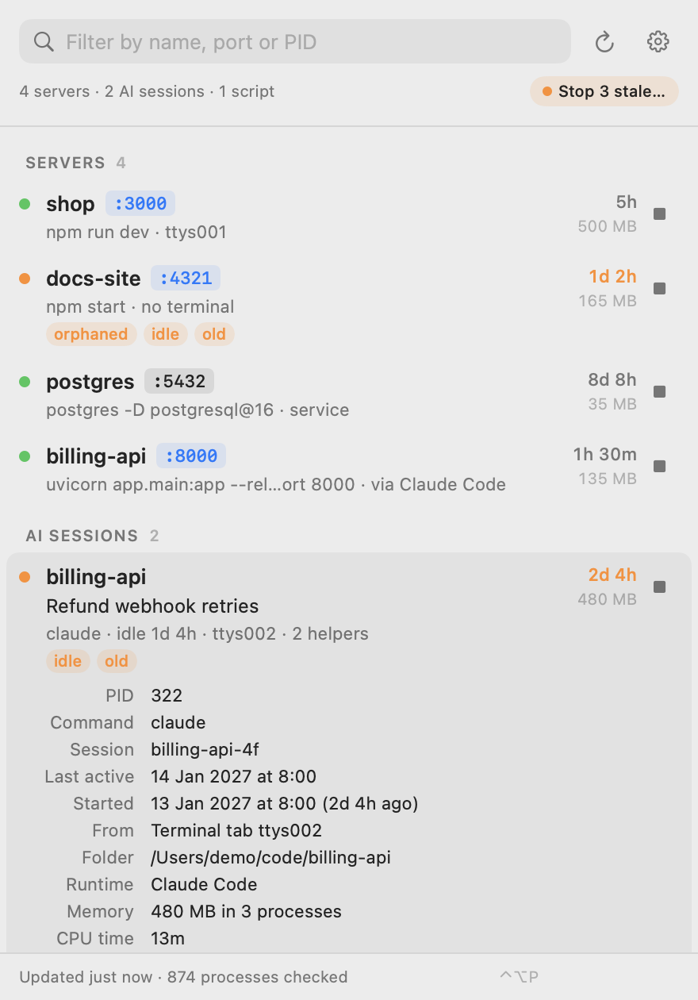
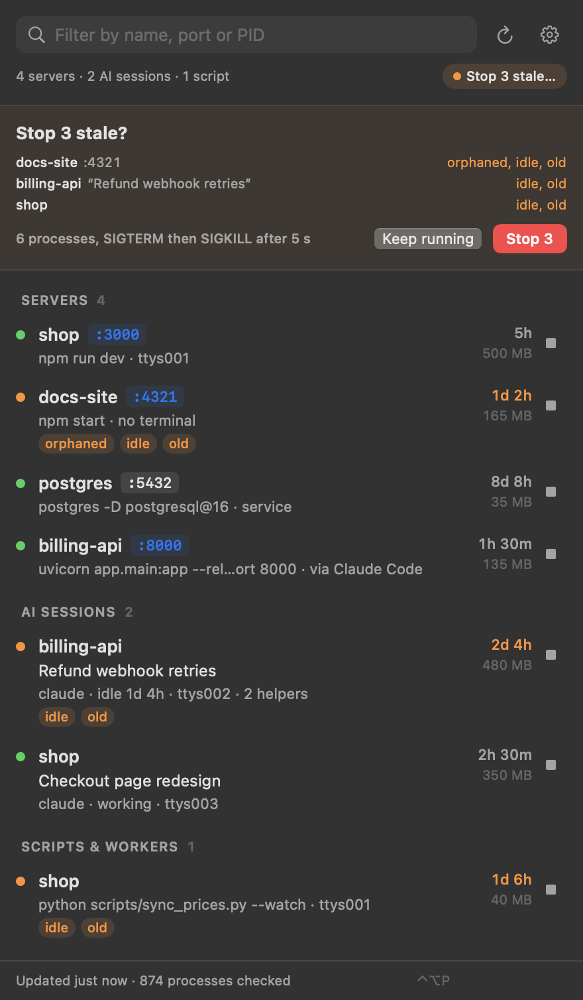

# Strays

**See and stop the dev servers, AI coding sessions and scripts you forgot were running.**

Strays is a small macOS menu-bar app (and a `strays` command) for people who start a lot of things in a lot
of terminal tabs: `npm run dev` here, a Python worker there, three Claude Code sessions with their MCP servers,
a server that lost its terminal two days ago and is still holding port 5173.

It shows what is running, which project it belongs to, which port it holds, how long it has been running and
whether anyone is still watching it, and it stops a thing *and everything it started* in two clicks.

<p align="center">
  
</p>

## What it shows

- **Servers**: anything of yours listening on a TCP port, named after its project folder (git root), with the
  command (`npm run dev`, `uvicorn app.main:app`), uptime, memory, and where it came from (a terminal tab, an AI
  session, launchd, or nowhere: *orphaned*). Ports that speak HTTP open in your browser with one click.
- **AI sessions**: Claude Code sessions with their conversation title, *idle 2d 4h* or *working*, the terminal
  tab they live in, and their MCP servers folded underneath. Codex, Gemini CLI, Aider and opencode are
  recognised too.
- **Scripts & workers**: Node, Python, Bun, Deno, Ruby, Go, Rust, Java, PHP, .NET and Elixir processes without a port.
- **Docker containers** with their published ports, when Docker Desktop, OrbStack or Colima is running.
- **System & apps** (collapsed): macOS and app processes that hold a port, with an explanation for the classic
  one: port 5000/7000 is macOS's AirPlay Receiver.

Rows that need attention get tags: **orphaned** (its terminal or parent is gone), **idle** (no real CPU use, or
an idle AI session, for 3 h), **old** (running over 24 h). The menu-bar paw gets an orange dot when anything is
stale, and a daily reminder (18:00 by default) lists what is still running.

## What it does

- **Stop**: click ■, then confirm the inline "Stop 4" (it says how many processes). Strays sends `SIGTERM` to the
  whole tree, top first, waits 5 s, then `SIGKILL`s whatever is left.
- **Stop stale…**: one confirm for everything tagged orphaned, idle or old. *Stop everything in &lt;project&gt;* is in
  the right-click menu.
- **Find a port**: type `:3000` (or `3000`, `localhost:3000`) in the filter to see who holds it, or that it is free.
- **Jump**: open in browser, show the Terminal/iTerm2 tab it runs in, open the project in Cursor (or VS Code,
  Zed, Xcode), copy PID / URL / command / folder.
- Global shortcut **⌃⌥P**, open at login, and settings for every threshold.

<p align="center">
  
  
</p>

Screenshots use made-up projects (`make snapshot` renders them from canned data).

## The command line

```text
strays [ls] [--all] [--json]   List servers, AI sessions and scripts (--all adds system & apps)
strays who <port>              Who is listening on a port (:3000, 3000, localhost:3000)
strays stop <target>... [-y]   Stop a row and everything it started. Target: :PORT, PID, or pid:PID
strays stale [--stop] [-y]     List orphaned / idle / old rows (and stop them)
```

```text
$ strays
SERVERS (2)
  :4321        docs-site              npm start                          up 1d 2h   no terminal (orphaned) · pid 340 · ⚠ orphaned, idle, old
  :8000        billing-api            uvicorn app.main:app --reload …    up 1h 30m  started by Claude Code · pid 325

AI SESSIONS (1)
  pid 322      billing-api            "Refund webhook retries"           up 2d 4h   idle 1d 4h · Terminal tab ttys002 · +2 helpers · ⚠ idle, old

$ strays who :5000
That's macOS's AirPlay Receiver. To free :5000, turn it off in System Settings > General > AirDrop & Handoff.
```

`strays stop` always shows exactly which processes it will signal and asks first (`-y` skips the question;
without a terminal it refuses rather than guessing). It shares its settings with the app.

## Install

Strays is built from source on your Mac; there is no prebuilt binary to trust.

**Homebrew**

```sh
brew install ShakoBatiashvili/strays/strays
cp -R "$(brew --prefix strays)/Strays.app" ~/Applications/ && open ~/Applications/Strays.app
```

**From source** (Xcode 16 or newer, macOS 14 or newer)

```sh
git clone https://github.com/ShakoBatiashvili/strays.git && cd strays
make test      # unit tests plus real-system tests (they start and stop their own throwaway processes)
make app       # dist/Strays.app, ad-hoc signed
make audit     # checks the safety claims below against the source and the built app
make install   # copies it to ~/Applications
ln -sf ~/Applications/Strays.app/Contents/Helpers/strays /usr/local/bin/strays   # the CLI, optional
```

The first time you use *Show terminal tab*, macOS asks whether Strays may control Terminal. The daily reminder
asks for permission to post notifications.

## Safety

Strays is meant to be trusted with a Stop button, so it is deliberately small. Details in [SECURITY.md](SECURITY.md).

- **Never more than your own rights.** No root, no helper, no `sudo`. Other users' processes and macOS itself are
  never stopped (and Strays won't stop the session it runs in).
- **No recycled-PID accidents.** Every signal is preceded by a live check that the PID still has the same start
  time and owner it had when you clicked.
- **No internet.** The only connections are to `localhost` (one `HEAD /` to see whether a port speaks HTTP) and to
  Docker's local unix socket. No telemetry, no updater.
- **Secrets stay hidden.** API keys, tokens and passwords on command lines (`--api-key …`, `TOKEN=…`,
  `postgres://user:pass@…`, `sk-…`, `ghp_…`, JWTs) are masked everywhere Strays shows or prints a command.
- **Read-only peeks at Claude Code.** It reads `~/.claude/sessions/<pid>.json` and the title lines of the session
  transcript; the token files beside them are never opened.
- **No third-party code**, no private APIs, one fixed subprocess (`/bin/launchctl list`, to tell brew services from
  orphans), one entitlement (Apple Events, for *Show terminal tab*). `make audit` checks all of this.

## Limits

- Without root, macOS only shows the details (ports, folder, arguments) of **your own** processes. A port held by
  another user is reported as "in use by something Strays can't see".
- "Idle" for ordinary processes means CPU use stayed under 0.5% of a core; a server that is quietly waiting for
  requests counts as idle. That is usually what you want to know, but it is a heuristic.
- Docker containers are listed from the engine's API; their port-forwarding helper is not shown twice.
- Tab jumping works for Terminal and iTerm2; for other terminals (Cursor, VS Code, tmux) Strays brings the app
  forward.

## License

MIT. See [LICENSE](LICENSE).
